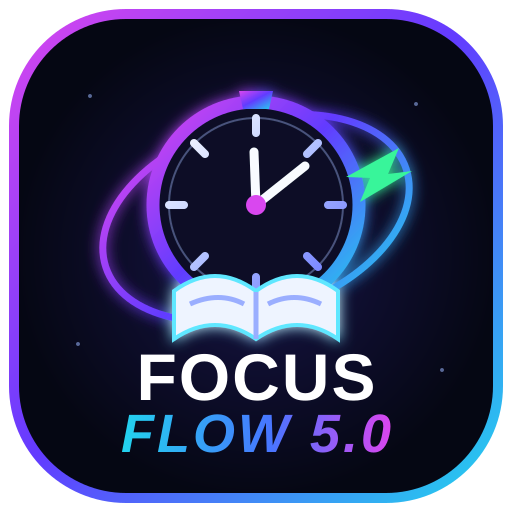

<div align="center">
  
  <h1>FOCUS FLOW 4.0</h1>
  <p><strong>Your personal study OS. Focus deeper. Learn smarter. Grow daily.</strong></p>
  <p>
    <a href="https://github.com/NATIONVK/FOCUS-FLOW-4.0/actions/workflows/quality.yml"></a>
    <a href="https://github.com/NATIONVK/FOCUS-FLOW-4.0/actions/workflows/build-android.yml"></a>
    
    
    
  </p>
  <p><em>Designed for distraction-free study, consistent habits, and measurable progress.</em></p>
</div>

---

## ✦ About the project

**FOCUS FLOW** is an offline-first study planner and productivity companion built with HTML, CSS, and JavaScript, then packaged for Android using Capacitor. It brings focus sessions, subject tracking, tasks, weekly planning, study analytics, notes, and image-to-PDF tools into one workspace.

The app is designed to keep your study records on your device by default. You can use its core workflow without depending on a cloud account or a constant internet connection.

## 🚀 What you can do

| Workspace | What it helps you do |
| --- | --- |
| **Focus Timer** | Run focus sessions, pause/resume, and recover timer state after reload. Android supports an ongoing foreground notification. |
| **Subjects** | Organize subjects and see study time recorded for each one. |
| **Tasks** | Create tasks, set priorities and due dates, filter work, and track completion. |
| **Weekly Planner** | Arrange study blocks across the week, launch a session from a plan, and compare planned time with actual focus time for today. |
| **Overview & Goals** | See today's study time, daily-goal progress, streaks, pending tasks, and today's planned work. |
| **Statistics & History** | Review study sessions and daily, weekly, monthly, and subject-level progress. |
| **Notes** | Keep quick study notes in the same workspace. |
| **PDF Maker** | Select multiple photos, reorder pages, choose page sizing, and export a PDF offline. Android can show recent gallery photos directly, with file-picker fallback. |
| **Themes & Settings** | Personalize the workspace and manage local data, including backup and restore options. |

## 📱 Android app

The Android app is packaged with **Capacitor 7**. The repository includes native Android bridges for the background focus timer and device photo gallery.

### Build an APK with GitHub Actions

1. Open the [Actions tab](https://github.com/NATIONVK/FOCUS-FLOW-4.0/actions).
2. Select **Build Android APK**.
3. Choose **Run workflow** (or push a commit to `main`).
4. Open the completed workflow run and download the `focus-flow-4.0-debug-apk` artifact.
5. Install the APK on an Android device and test the features you use.

> A successful web build or workflow badge does not by itself confirm every feature works on every Android device. Always install and test the APK on a real device. Background execution and photo permissions can vary by Android version and device manufacturer.

## 🧰 Tech stack

- **HTML5** — app shell and semantic structure
- **CSS3** — responsive layout, themes, and interface styling
- **Vanilla JavaScript (ES modules)** — application logic and interactions
- **Vite 6** — development server and production bundling
- **Capacitor 7** — Android packaging and native bridge
- **Java** — Android foreground timer and gallery integration
- **jsPDF** — offline PDF generation
- **Node.js test runner** — core logic tests
- **GitHub Actions + Gradle** — automated quality checks and APK builds

## 🗂️ Project structure

```text
FOCUS-FLOW-4.0/
├── .github/workflows/       # Quality checks and Android APK workflow
├── native/android/          # Native timer, gallery, and activity bridges
├── public/                  # Static assets and app icon
├── src/
│   ├── analytics.js         # Study analytics and streak calculations
│   ├── main.js              # App rendering and interactions
│   ├── pdf-maker.js         # Image selection and PDF creation
│   ├── store.js             # Local app data and persistence
│   ├── styles.css           # Responsive UI and themes
│   └── timer.js             # Focus timer logic
├── tests/                   # Core unit tests
├── index.html               # Web app entry point
├── manifest.webmanifest     # PWA metadata and icon
└── package.json             # Scripts and dependencies
```

## 💻 Run locally

**Requirements:** Node.js 22+ and npm. Android builds additionally require the Android toolchain; the GitHub Actions workflow configures it automatically.

```bash
git clone https://github.com/NATIONVK/FOCUS-FLOW-4.0.git
cd FOCUS-FLOW-4.0
npm install
npm test
npm run dev
```

Create a production web build:

```bash
npm run build
npm run preview
```

## 🤖 Build Android locally

```bash
npm install
npm run build
npx cap add android       # only if the Android platform has not been added
npx cap sync android
```

Then open the generated `android/` project in Android Studio, or build a debug APK with Gradle:

```bash
cd android
./gradlew assembleDebug
```

## 🔐 Privacy & data

- Study records are stored locally on the device by default.
- No cloud sync or account system is required for the core study workflow.
- Export a backup before clearing app storage or uninstalling the app.
- Gallery access is requested when the PDF Maker needs it; Android may offer full or selected-photo access depending on the OS version and user choice.

## 🧭 Development status

FOCUS FLOW 4.0 is actively evolving. The repository includes automated core tests and an Android APK workflow. Native behavior—especially background execution, notifications, and gallery permissions—should be validated on physical devices across supported Android versions.

### Planned improvements

- More detailed subject-wise and weekly insights
- Richer study reports and export options
- Further dashboard and accessibility refinements
- Continued Android reliability and performance improvements

## 🤝 Contributing

Suggestions, bug reports, and pull requests are welcome. Before opening a pull request, run:

```bash
npm test
npm run build
```

Please include clear reproduction steps for bugs and device/Android-version details for native issues.

## 📄 License

No license has been added yet. Unless a license is added to this repository, standard copyright restrictions apply; please contact the repository owner before redistributing or reusing the project.

---

<div align="center">
  <strong>FOCUS FLOW 4.0</strong><br>
  <sub>Build focus. Track progress. Find your flow.</sub><br><br>
  <a href="https://github.com/NATIONVK/FOCUS-FLOW-4.0">GitHub Repository</a> ·
  <a href="https://github.com/NATIONVK/FOCUS-FLOW-4.0/issues">Report an issue</a> ·
  <a href="https://github.com/NATIONVK/FOCUS-FLOW-4.0/actions">Builds & checks</a>
</div>
